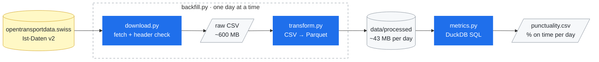

# Swiss Rail Punctuality


Daily train punctuality in Switzerland, computed from the open delay data
on opentransportdata.swiss.

## Result

93.56% of train arrivals were on time over 29 days (4 Sep to 2 Oct 2026,
4,025,730 arrivals).

SBB reports 94.1% for 2025. I wouldn't expect the two numbers to match,
since they measure different things:

- SBB counts its own network. This dataset covers every Swiss operator.
- SBB weights by passengers carried. Here every stop counts the same.
- The periods differ.
- The measurement points differ.

The unweighted number is the one I wanted, because the Federal Office of
Transport has criticised passenger-weighted punctuality for hiding how
individual routes actually perform.

An arrival counts as on time if it is at most 3 minutes late.
Cancelled trains are left out.

## Reproduce

```bash
uv sync
uv run python src/swiss_rail_punctuality/backfill.py 2026-09-04 2026-10-02
uv run python src/swiss_rail_punctuality/metrics.py
```

The result is written to `output/punctuality.csv`.

## How it works



Download and conversion skip days already done, so a day that is already
downloaded or converted gets passed over. `backfill.py` chains these two
steps over a date range. If a single day fails it keeps going and lists the
failures at the end.

### Why Parquet

One day of raw data is 608 MB as CSV and 43 MB as Parquet, about 14× smaller.
The types are stored too, so nothing gets re-parsed on every read. The CSV is
deleted after conversion, which keeps peak disk use to one CSV plus the
Parquet files accumulated so far.

### Why DuckDB

The metric is a single aggregation over a few columns, run occasionally.
There are no concurrent transactions, so a database server would be overkill.
DuckDB reads the Parquet files where they sit, with no server to run and no
data to load first. Aggregating 29 files (~71M rows) takes 0.1 s. 

## Known limits

- Only 29 days of data. The source's CKAN API returns 403 without a key, so
  the download parses the dataset's HTML page instead, and that page only
  lists recent days. Going further back would need the monthly archive, which
  works differently.
- For the same reason, the reproduce commands will stop working once those
  dates fall off the page.
- The on-time threshold and the output paths are parameters of
  `punctuality()`. Everything else is hardcoded.

## Documentation

- `docs/data_profile.md`: what the source contains, column by column
- `docs/decisions.md`: the choices made and why
- `docs/benchmark.md`: the measurements quoted above