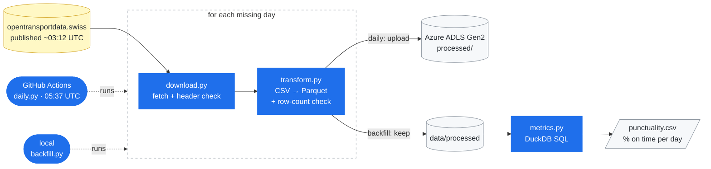

# Swiss Rail Punctuality


Daily train punctuality in Switzerland, computed from the open delay data
on opentransportdata.swiss. The data is collected automatically every morning
and stored in Azure.

## Result

93.56% of train arrivals were on time over 29 days (4 Sep to 2 Oct 2026,
4,025,730 arrivals).

SBB reports 94.1% for 2025. I wouldn't expect the two numbers to match,
since they measure different things:

- SBB counts its own network. This dataset covers every Swiss operator.
- SBB weights by passengers carried. Here every stop counts the same.
- The periods differ.
- The measurement points differ.

The unweighted number is the one I wanted, because the Federal Office of
Transport has criticised passenger-weighted punctuality for hiding how
individual routes actually perform.

An arrival counts as on time if it is at most 3 minutes late.
Cancelled trains are left out.

## Reproduce

```bash
uv sync
uv run python src/swiss_rail_punctuality/backfill.py 2026-10-20 2026-10-26
uv run python src/swiss_rail_punctuality/metrics.py
```

`backfill.py` collects a date range on your machine, and `metrics.py` computes
the result from whatever days are on disk. It is written to
`output/punctuality.csv`. The source only keeps about 50 days, so pick recent
dates.

## How it works



Every day goes through the same steps: download the CSV, convert it to
Parquet, count its rows, and only then give the file its final name. A day
with far fewer rows than usual for its day of the week is rejected, so a bad
file is never mistaken for a finished one.

Two scripts drive these steps:

- `daily.py` runs on GitHub Actions every morning. It looks at the last 7
  days, skips the ones already in Azure and uploads the rest, so a missed run
  is caught up the next morning.
- `backfill.py` is the manual tool: any date range, files kept on the local
  disk.

A day that fails does not stop the others, but the run still ends in error.
GitHub then marks it red and sends me an email.

### Why GitHub Actions and Azure

The source deletes its files after about 50 days, so collection cannot depend
on my macbook being on. GitHub Actions is free for a public repository and
already runs the CI. The machine it lends is wiped after each run, so the
files live in Azure Blob Storage, which is also where the job checks what is
already done.

### Why Parquet

One day of raw data is 608 MB as CSV and 43 MB as Parquet, about 14× smaller.
The types are stored too, so nothing gets re-parsed on every read. The CSV is
deleted after conversion, which keeps peak disk use to one CSV plus the
Parquet files accumulated so far.

### Why DuckDB

The metric is a single aggregation over a few columns, run occasionally.
There are no concurrent transactions, so a database server would be overkill.
DuckDB reads the Parquet files where they sit, with no server to run and no
data to load first. Aggregating 29 files (~71M rows) takes 0.1 s. 

## Known limits

- History starts on 1 September 2026. The source's CKAN API returns 403
  without a key, so the download reads the dataset's HTML page, which only
  lists recent days. Going further back would need the monthly archive.
- The result above still covers the first 29 days. `metrics.py` reads local
  files only and is not part of the daily job yet.
- GitHub does not guarantee the start time of scheduled runs, and disables
  them after 60 days without activity on the repository.
- The row-count check only catches large losses, and weekday public holidays
  will trigger false alarms.
- The SAS token used by the job expires on 26 January 2027 and has to be
  renewed by hand.
- The on-time threshold and the output paths are parameters of
  `punctuality()`. Everything else is hardcoded.

## Documentation

- `docs/data_profile.md`: what the source contains, column by column
- `docs/decisions.md`: the choices made and why
- `docs/benchmark.md`: the measurements quoted above